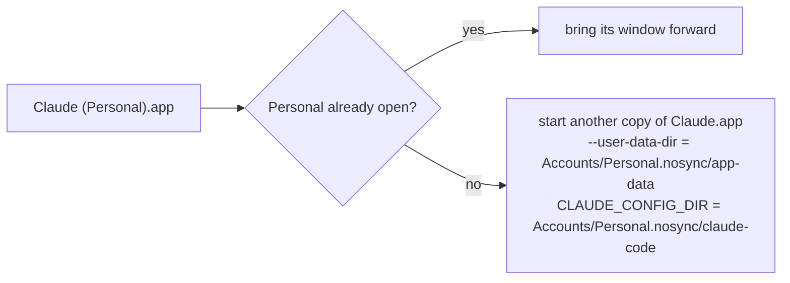

# Claude Multiple Accounts

**Use the Claude desktop app on macOS with more than one account at the same time**, for example work and personal, each in its own window with its own login, settings and Code tab.

- **One double-click to add an account.** *Add New Account* asks for a name, sets everything up and opens a fresh Claude window to sign in.
- **One double-click to open it.** Each account gets its own launcher, such as **Claude (Personal)**, labelled with its name.
- **Fully separate accounts.** Login, settings, connectors / MCP servers, and the Code tab's settings, plugins and history (`~/.claude`) are kept apart.
- **Safe to click twice.** Claude has no built-in guard against two copies of the app using the same account folder, and that can corrupt it. The launchers check first and just bring the open window forward.
- **Nothing modified.** `Claude.app` is left untouched, so updates keep working, and your existing account stays exactly where it is.
- **iCloud-friendly.** Account data lives in `.nosync` folders, so it stays on your Mac even if the folder is on an iCloud-synced Desktop.
- **No dependencies.** Only tools that ship with macOS: AppleScript, zsh and `codesign`.

> [!NOTE]
> This is an unofficial tool, not affiliated with or endorsed by Anthropic. It relies on the standard Electron/Chromium `--user-data-dir` switch, which the Claude app doesn't document, so a future Claude update could change how it behaves.

## Requirements

- macOS 14 Sonoma or later (tested on macOS 26 on Apple Silicon)
- The [Claude desktop app](https://claude.ai/download) in `/Applications`

## Install

1. Download or clone this repository and put the folder wherever you like, for example in Documents.
2. Build the apps, from that folder in Terminal:

   ```bash
   zsh .source/make-launcher.sh . --build
   ```

This creates **Add New Account** and **Claude (Default)** in the folder. Everything is built and signed (ad hoc) on your own Mac, so Gatekeeper doesn't get in the way.

## Usage

### Add an account

1. Double-click **Add New Account**.
2. Type a name, for example `Personal`.
3. If Claude is open, let it quit Claude for you (recommended, see [Signing in](#signing-in)).
4. A fresh Claude window opens. Sign in with the other account.

You now have a **Claude (Personal)** launcher next to *Add New Account*. Run *Add New Account* again whenever you want another account.

### Open an account

| Double-click | Opens |
| --- | --- |
| **Claude (*Name*)** | that account, or brings its window forward if it's already open |
| **Claude (Default)** | your usual account, even while another account is open |

You can drag the launchers to the Dock. While another account is open, the normal Claude icon in the Dock or Spotlight just brings an already-open Claude window forward, which might be the other account. **Claude (Default)** always gets you your usual one.

## Good to know

#### Signing in
Sign-in links return to *a* Claude window, and macOS picks which one. So whenever you sign in to an account (the first time, or after being signed out), quit the other Claude windows first. The same applies to connecting a connector that finishes in your browser.

#### Updates
A Claude update can only install when *all* Claude windows are closed. If Claude says an update is waiting, quit every account, let it update, then reopen the accounts from their launchers. After an update, Claude restarts with your default account. An extra account that sits idle may also close itself when an update is ready; just reopen it.

#### What's separate and what's shared
| Separate per account | Shared |
| --- | --- |
| login and chats | the Claude app itself and its updates |
| settings | logs (`~/Library/Logs/Claude`) |
| connectors / MCP servers | "Open at login" and global keyboard shortcuts (leave them off in extra accounts) |
| Code tab settings, plugins and history | |

#### Also
- **First use is slower.** The first time you open the Code tab in a new account, Claude downloads its Code component (about 250 MB). Cowork downloads its virtual machine (a few GB) if you use it.
- **Claude in Chrome** may not pair with extra accounts; Claude turns local pairing off for profiles stored outside its usual folder.
- **In the Dock and ⌘-Tab**, every account shows the normal Claude icon. Only the launchers carry the name labels.

## Remove an account

Quit that account's Claude window, then delete both of these:

- `Claude (Name).app`
- `Accounts/Name.nosync`

Deleted only the launcher by mistake? Run **Add New Account** with the same name. It offers to recreate the launcher and leaves the account as it is.

## Moving the folder

- Moving the whole folder is fine; quit the extra accounts first. Launchers find their account next to them.
- Copying a single launcher somewhere else (for example to `Applications`, for Spotlight) also works, as long as the folder stays put.

## How it works



Each launcher starts an additional copy of the normal `/Applications/Claude.app` with `open -n`:

- `--user-data-dir` points Claude at the account's own folder instead of `~/Library/Application Support/Claude`. That folder holds the login, settings and connectors.
- `CLAUDE_CONFIG_DIR` gives the Code tab its own config folder instead of `~/.claude`.

Before starting anything, the launcher checks your running Claude processes for that account's folder and, if it finds one, brings that window forward instead.

```text
claude-multiple-accounts/
├── Add New Account.app        built by --build
├── Claude (Default).app       built by --build
├── Claude (Personal).app      one per account, made by Add New Account
├── Accounts/
│   └── Personal.nosync/       that account's data (stays on this Mac)
│       ├── app-data/          Claude's profile: login, settings, connectors
│       └── claude-code/       the Code tab's config (CLAUDE_CONFIG_DIR)
└── .source/
    ├── add-account.applescript    the "Add New Account" app
    ├── launcher.applescript       every launcher (reads its account from Info.plist)
    ├── make-launcher.sh           creates account folders and builds the apps
    └── make-icon.js               draws the name label on Claude's icon
```

After editing the sources, rebuild *Add New Account* with the same command as in [Install](#install).

## Troubleshooting

- **"Add New Account would like to access files in your … folder."** Click **Allow**. It needs that to create the account folder there.
- **Sign-in finished in the wrong window.** Quit all Claude windows except the account you're signing in to, then sign in again.
- **"Can't find the account"** from a copied launcher. The folder was moved. Use the launcher inside the folder, or copy it again from there.
- **After an update, an extra account's window shows your default account.** Claude restarts with the default account after updating; open the other account again from its launcher.

## License

MIT. See [LICENSE](LICENSE).
